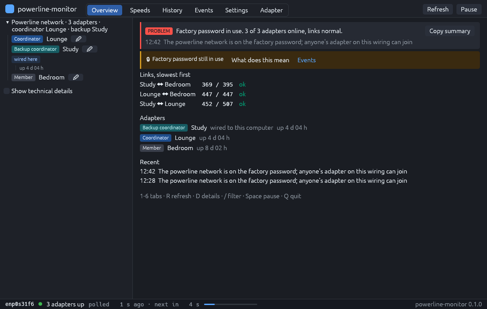
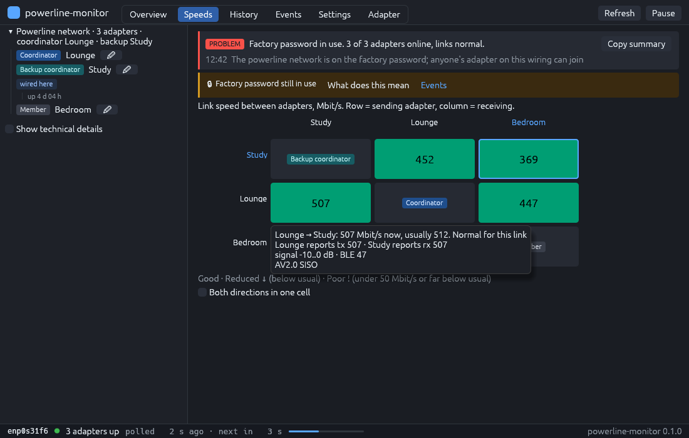
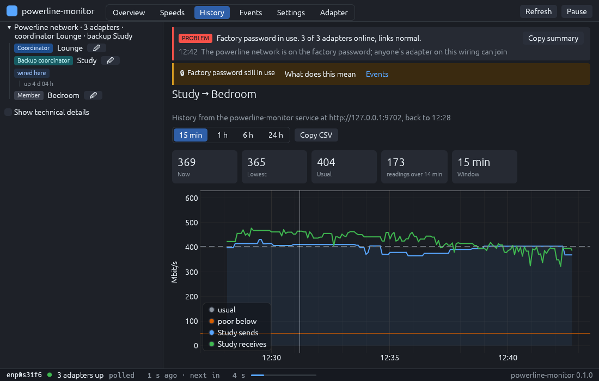
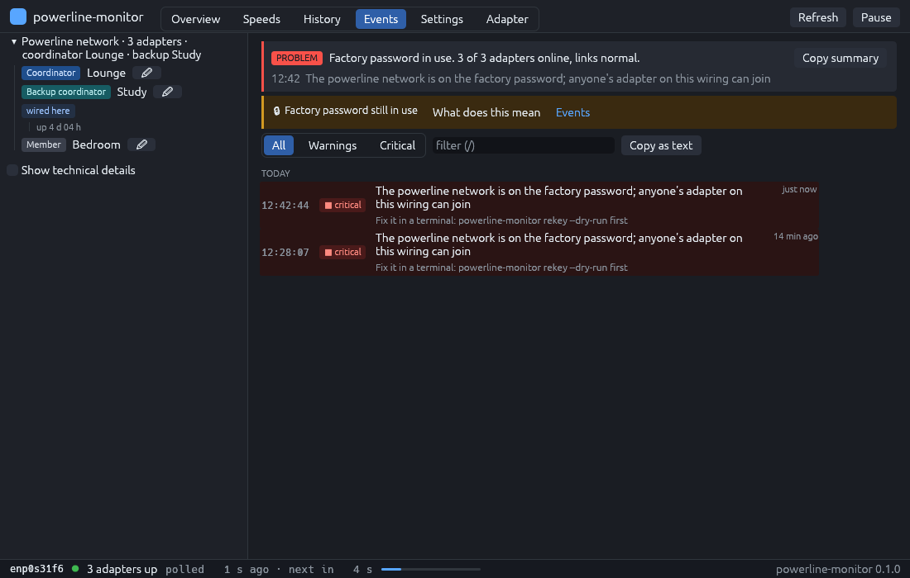
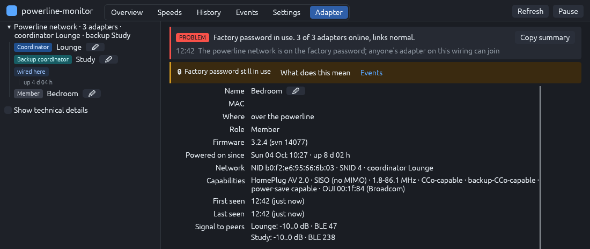

# powerline-monitor

A Linux monitor for HomePlug AV / AV2 powerline adapters (TP-Link, Devolo,
Netgear, Zyxel and other Broadcom-based units). One binary gives you a
desktop window, a live terminal view and a daemon with Prometheus metrics, a
JSON API, link-speed history and event hooks.

It talks to the adapters directly over raw Ethernet, so it needs no vendor
software, no Windows machine and no cloud account. On Linux it stands in for
TP-Link's tpPLC utility and for `pla-util` in day-to-day use.



## What it does

- Finds every adapter on your mains wiring, shows which one coordinates the
  network and which one is wired to this computer.
- Shows the PHY link rate between every pair of adapters, flags links that are
  slow or below their usual rate, and keeps up to 30 days of history.
- Warns when the network still runs on the factory password `HomePlugAV`,
  when an unknown adapter joins, when an adapter drops off or reboots, and
  when the coordinator changes.
- Runs as a daemon: Prometheus `/metrics`, a JSON API, an event log, and a
  hook that runs a program of yours for every event.
- Sets a new network key (`rekey`) with a dry run, a typed confirmation and a
  printed recovery path. That is the only write it ever makes.
- Never reads, prints or stores network keys, device keys or passphrases.

| Speeds | History |
|---|---|
|  |  |

| Events | Adapter |
|---|---|
|  |  |

## Supported hardware

| Adapter | Chip | Status |
|---|---|---|
| TP-Link TL-PA7017 (V4) | Broadcom BCM60355 | Tested: every read, the daemon, the window; `rekey` verified up to `--dry-run` |
| Other Broadcom-based HomePlug AV2 adapters (later TP-Link revisions, Devolo, Netgear, Zyxel) | Broadcom | Expected to work, untested. Reports welcome |
| Qualcomm / Atheros adapters (QCA7xxx) | Qualcomm | Not supported yet. They show up as "seen by peers, not answering" |

Every adapter on the wiring is reachable through any one adapter's Ethernet
port, so one wired adapter next to the host is enough.

## Install

Requirements: a stable Rust toolchain, `setcap` (package `libcap`), and a
wired Ethernet port plugged into one of the adapters. The window needs a
Wayland or X11 session. Raw Ethernet needs `CAP_NET_RAW`; the installers grant
it to the binary as a file capability, so no command needs `sudo` afterwards.

### From source

```sh
git clone https://github.com/MPMyburgh/powerline-monitor
cd powerline-monitor
./install.sh
```

This builds the release binary, installs it to `~/.local/bin/powerline-monitor`
with `CAP_NET_RAW`, adds the **Powerline Monitor** application-menu entry,
icons and shell completions, and writes `~/.config/powerline-monitor/config.toml`
with your wired interfaces filled in. An existing config is kept.

`./install.sh --service` also installs and starts a systemd user unit that
runs the daemon. Enable lingering (`loginctl enable-linger`) if it should
survive logout.

### Arch Linux

```sh
cd packaging && makepkg -si
sudo systemctl enable --now powerline-monitor
```

Installs `/usr/bin/powerline-monitor`, a hardened system unit, `/etc/powerline-monitor.toml`,
the desktop entry, icons and completions.

## Quick start

```sh
powerline-monitor discover            # list the adapters
powerline-monitor status              # verdict, roles, link speeds; exit 1 on a warning, 2 on a problem
powerline-monitor watch               # live terminal view with sparklines
powerline-monitor                     # desktop window
powerline-monitor check-default-key   # still on the factory password?
powerline-monitor rekey --dry-run     # plan a new network key; nothing is written
```

Name your adapters so output reads as rooms rather than MACs:
`powerline-monitor rename 1b2c Study`, or use the Settings tab. Names live in
the config file; the adapters themselves are never written.

## Commands

```
powerline-monitor [--config PATH] [-i IFACE]... [--daemon URL] <command>
```

| Command | What it does |
|---|---|
| `discover` | List the adapters on each interface (`--json`, `--toml` for config snippets) |
| `status` | One poll: verdict, adapters, link-rate matrix (`-v` for protocol detail, `--json`) |
| `watch` | The status view redrawn after every poll, with sparklines (`--lines` for logs) |
| `ui` | The desktop window (default when no command is given) |
| `daemon` | Poll continuously; serve `/metrics` and `/api/*` |
| `history` | Link-speed history from the daemon: every link, or an hourly grid for one pair |
| `events` | Events the daemon recorded (`--follow`, `--since 6h`, `--severity warning`) |
| `rename` | Give an adapter a local name |
| `check-default-key` | Report whether the network uses the factory passphrase |
| `rekey` | Write a new network key (`--dry-run` first) |
| `config validate` / `config show` | Check or print the config |
| `export` | One poll as Prometheus text for node_exporter's textfile collector |
| `completions` | Shell completion scripts |

Full reference, output samples and exit codes: [docs/commands.md](docs/commands.md).

## Daemon and Prometheus

```sh
powerline-monitor daemon --listen 127.0.0.1:9702
curl -s http://127.0.0.1:9702/metrics | grep homeplug_
```

The daemon serves `/metrics` (namespace `homeplug_`, compatible with
homeplug_exporter dashboards), `/api/state`, `/api/history`, `/api/events`
and `/api/status`. Any command and the window can attach to a daemon with
`--daemon URL`, which needs no raw-socket capability on that machine.

Endpoints, event kinds, the hook contract and every metric:
[docs/daemon.md](docs/daemon.md).

## Configuration

TOML, every key optional. `packaging/powerline-monitor.toml.example` is a
commented copy; `config show` prints the effective values.

```toml
interfaces    = ["enp0s31f6"]
poll_seconds  = 30
history_hours = 24
listen        = "127.0.0.1:9702"

[devices."20:e1:5d:0a:1b:2c"]
alias = "Study"

[hooks]
exec = ["/usr/local/bin/plc-alert"]
min_severity = "warning"
```

All keys, alert thresholds and the state directory: [docs/configuration.md](docs/configuration.md).

## Safety

- The frame encoder refuses any management message that is not on a
  compiled-in allowlist of eight reads and one write (`rekey`). Firmware,
  flash, memory, reset and restart messages cannot be sent.
- No key material is ever requested from an adapter. The factory-key check
  compares network IDs, which are derived from the key.
- `rekey` prints its plan, has a `--dry-run`, and writes only after you type
  `REKEY` on the terminal.
- The HTTP API has no authentication. Keep `listen` on loopback or a VPN
  interface.

Details: [docs/safety.md](docs/safety.md).

## Related tools

- **tpPLC** (TP-Link): the vendor utility, Windows and macOS only.
  [docs/vendor-coverage.md](docs/vendor-coverage.md) lists what it does and
  where this tool stands.
- **[pla-util](https://github.com/serock/pla-util)**: Broadcom CLI in Ada, no
  daemon or GUI. Its NID output is byte-reversed compared with this tool.
- **[open-plc-utils](https://github.com/qca/open-plc-utils)**: Qualcomm Atheros
  adapters only.
- **[homeplug_exporter](https://github.com/NightTsarina/homeplug_exporter)**:
  Prometheus exporter; the shared metric names here keep its dashboards working.
- **[plcmon](https://github.com/lexicone42/plcmon)**: HomePlug AV terminal UI in Rust.

## Contributing

Reports from other Broadcom adapters are the most useful contribution: run
`powerline-monitor status -v` and `status --json`, then open an issue with the output and the
adapter model. Pull requests are welcome; keep the send allowlist unchanged
unless the message has been verified on hardware.

## Licence

MIT. See [LICENSE](LICENSE).

The Broadcom message layouts follow what pla-util documented; the key
derivation and standard message layouts follow the HomePlug AV specification
as implemented in open-plc-utils and homeplug_exporter.
